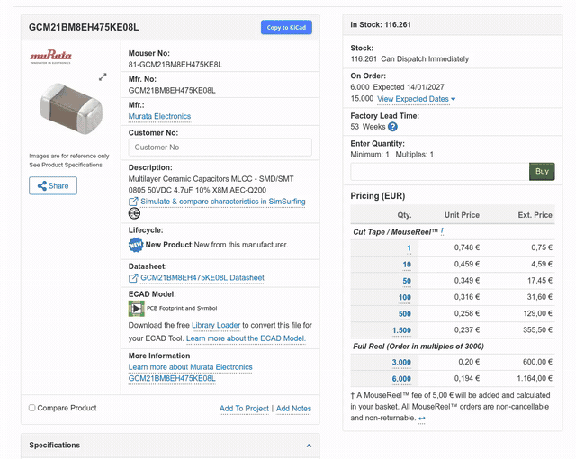
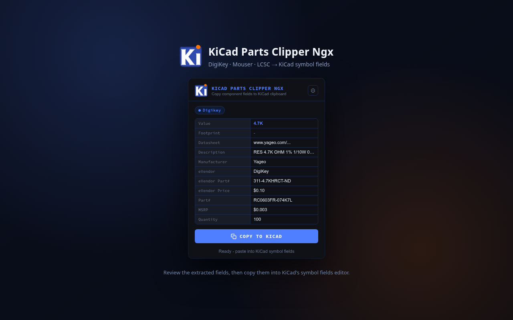
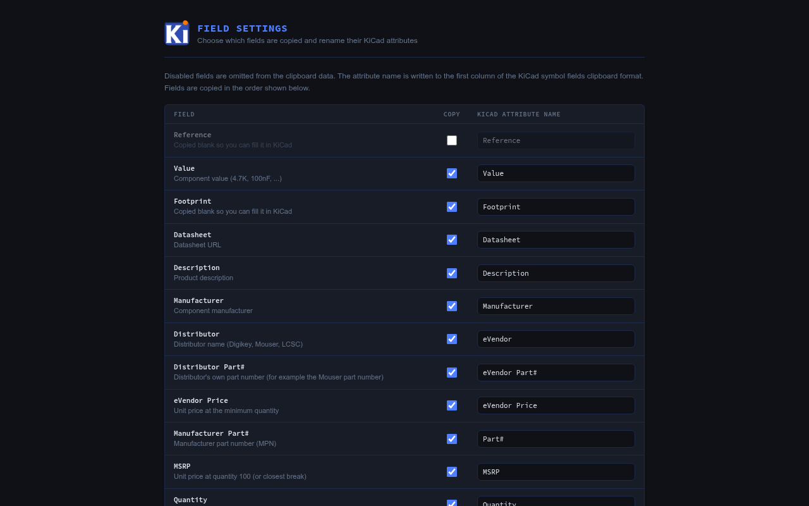

# KiCad Parts Clipper Ngx

A fork of the original **KiCad Parts Clipper** extension (`kicad-parts-clipper@novasmar.com`).

This fork keeps the original workflow and adds German storefront support, configurable KiCad fields, distributor part numbers, and an on-page copy button. It uses its own extension ID (`kicad_parts_clipper_ngx@marcelrobitaille.me`) so it can be published and installed alongside the original.

## Features

- **Supported sites:** DigiKey, Mouser, and LCSC, including `digikey.de`, `mouser.de`, `digikey.com.br`, and `mouser.com.br`.
- **Part data:** manufacturer part number, distributor part number (for example the Mouser part number), manufacturer, description, datasheet URL, unit price, quantity-100 price (MSRP), and matching quantity.
- **Smart values:** formats resistance, capacitance, and inductance into KiCad-friendly values such as `4.7K`, `100nF`, and `10uH`.
- **KiCad clipboard format:** copies rows in the symbol-fields TSV format, ready to paste into KiCad.
- **Configurable fields:** enable or disable each row and rename its KiCad attribute in the settings page.
- **On-page copy button:** appears near the product attributes so you can copy without opening the popup. On Mouser it sits in the product header next to the part number.
- **Popup preview:** shows the extracted values and lets you copy from the toolbar popup.
- **No data collection:** everything runs locally in the browser.

## Screenshots



Popup (if you click the AddOn on the product page instead of the inlined "Copy to KiCad" button):



Field settings page:



## Privacy

The extension does not collect or transmit personal data, and its settings stay in local extension storage. See [PRIVACY.md](PRIVACY.md) for the full policy.

## Usage

1. Open a product page on a supported site.
2. Copy the data using either:
   - the **Copy to KiCad** button on the page, or
   - the toolbar icon, then **COPY TO KICAD**.
3. In KiCad, open the symbol properties/fields and paste the clipboard. See [Pasting into KiCad](#pasting-into-kicad) for the exact row and column to start from.
4. To choose which fields are copied or rename their attributes, open the extension settings (gear icon in the popup or the add-on's Options page).

### Pasting into KiCad

KiCad pastes a tab-separated block starting at the selected cell; it does not match rows by field name. To keep the data aligned:

- Click **once** in the **Name** cell of the **Value** row (the second row). The Reference row is omitted by default so an existing reference designator is not overwritten. If you enable the **Reference** field in the extension settings, start on the Reference row instead.
- Do not drag-select cells or rows. With more than one row or cell selected, KiCad repeats the clipboard to fill the selection, which scrambles the result.
- Keep all eight field columns visible: `Name`, `Value`, `Show`, `Show Name`, `H Align`, `V Align`, `Italic`, `Bold`. KiCad skips hidden columns when pasting, which shifts every value into the wrong column.
- If a symbol already has custom fields in a different order, paste into a row that lines up with the first field the extension copied, or paste the block into a new/blank symbol first.

## Install

### Firefox

The built XPI is unsigned.

- **Temporary (development):** open `about:debugging#/runtime/this-firefox`, choose **Load Temporary Add-on**, and select `manifest.json` or the built XPI.
- **Permanent:** publish/sign the add-on through [addons.mozilla.org](https://addons.mozilla.org/) or use a Firefox build with signature enforcement disabled.

### Chrome

- **Development:** run `./build-chrome.sh`, open `chrome://extensions`, enable **Developer mode**, choose **Load unpacked**, and select `./kicad_parts_clipper_ngx_chrome_unpacked`.
- **Publishing:** upload `./kicad_parts_clipper_ngx_chrome_v<version>.zip` to the [Chrome Web Store](https://chrome.google.com/webstore/devconsole).

## Build

### Firefox

```sh
./build-firefox.sh
```

This writes `./kicad_parts_clipper_ngx_v<version>.xpi` (for example, `kicad_parts_clipper_ngx_v2_0_0.xpi`).
The version is read from `manifest.json`.

### Chrome

```sh
./build-chrome.sh
```

This writes `./kicad_parts_clipper_ngx_chrome_v<version>.zip` and an unpacked copy at `./kicad_parts_clipper_ngx_chrome_unpacked/`. The Chrome build removes Firefox-only manifest keys such as `browser_specific_settings`.
The version is read from `manifest.json`.
